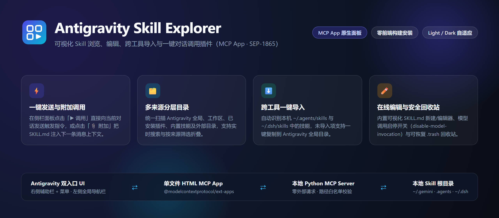
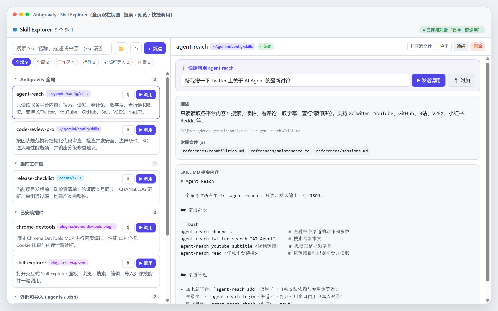
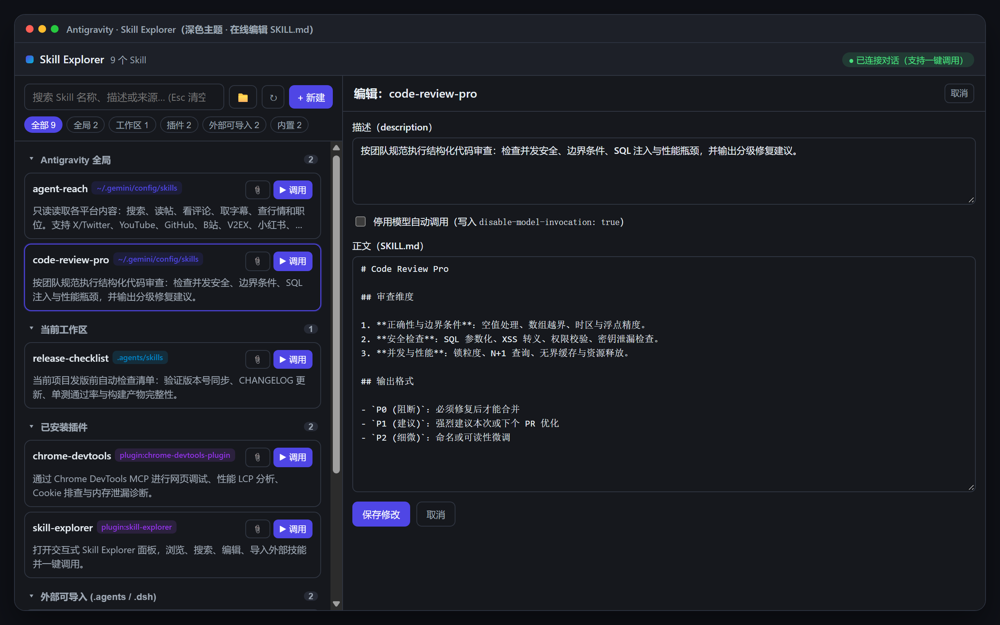
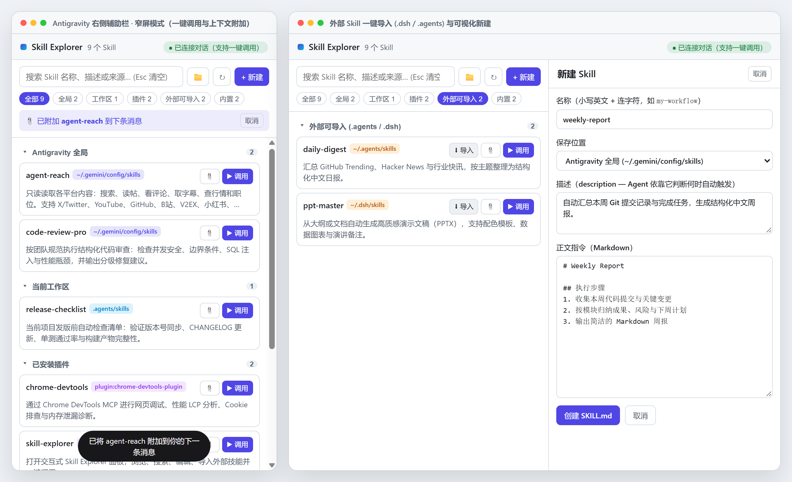

<p align="center">
  
</p>

<h1 align="center">Antigravity Skill Explorer</h1>

<p align="center">
  <strong>专为 Google Antigravity 构建的可视化 Skill 浏览器与一键调用中心插件（MCP App · SEP-1865）</strong>
</p>

---

## 界面与功能预览

### 1. 全页双栏视图（浅色主题 · 分类浏览 / 详情预览 / 快捷调用）

按来源自动分组扫描本地全部 Skills（Antigravity 全局、当前工作区、已安装插件、外部可导入与内置技能），右侧可直接输入具体任务并一键向当前对话发送调用指令或附加为下条消息上下文：



### 2. 深色主题自适应与在线编辑 `SKILL.md`

自动跟随 Antigravity 的明暗主题与样式变量；对全局或工作区可写 Skill 支持直接在线修改 `description`、启停模型自动调用（`disable-model-invocation`）以及编辑 Markdown 正文，删除时安全移入 `.trash` 回收站：



### 3. 侧栏窄屏模式、上下文附加与跨工具一键导入

在 Antigravity 右侧辅助栏打开时自动切换为紧凑窄屏布局，支持一键调用与 `📎 附加到下条消息`；同时自动扫描本机 `~/.agents/skills` 与 `~/.dsh/skills`，点击 **⬇ 导入** 即可一键复制到 Antigravity 全局目录，也支持通过表单可视化新建 Skill：



---

## 核心特性

- **双入口原生集成**：支持从 Antigravity **右侧辅助栏 `+` 菜单**（侧栏模式）和 **左侧全局导航栏**（全页双栏模式）打开，也可在对话里直接说“打开 Skill Explorer”。
- **按来源分类浏览**：自动扫描并分类展示：
  - Antigravity 全局 Skills（`~/.gemini/config/skills`）
  - 当前工作区 Skills（`.agents/skills`、`.agent/skills` 等，支持指定工作区路径）
  - 已安装插件 Skills（`~/.gemini/config/plugins/*/skills`）
  - 外部可导入 Skills（`~/.agents/skills`、`~/.dsh/skills`、`~/.gemini/skills`）
  - Antigravity 内置 Skills（默认折叠）
- **一键调用与上下文附加**：
  - 点击 **▶ 调用** 可输入具体任务并直接通过 `sendMessage` 向当前对话发送调用指令（全页模式自动降级为复制指令）。
  - 点击 **📎 附加** 可将 `SKILL.md` 作为上下文附加到下一条消息。
- **在线管理与跨工具导入**：
  - 支持对全局/工作区 Skill 在线新建、编辑 `SKILL.md`、启停 `disable-model-invocation`、安全移入 `.trash` 回收站，以及在侧栏打开源文件。
  - 支持将 `~/.agents/skills` 或 `~/.dsh/skills` 中的 Skill 一键导入到 Antigravity 全局目录。
- **零前端构建依赖**：仓库已内置打包好的单文件 [ui/app.html](ui/app.html)，安装时只需要 Python 3.10+（或 `uv`）。

---

## 一键安装

### Windows (PowerShell)

```powershell
git clone https://github.com/wwwww-alt/antigravity-skill-explorer.git
cd antigravity-skill-explorer
powershell -ExecutionPolicy Bypass -File .\install.ps1
```

### macOS / Linux

```bash
git clone https://github.com/wwwww-alt/antigravity-skill-explorer.git
cd antigravity-skill-explorer
chmod +x ./install.sh && ./install.sh
```

安装脚本会自动：
1. 将插件复制到 `~/.gemini/config/plugins/skill-explorer/`；
2. 创建独立 Python 虚拟环境 `.venv` 并安装 `requirements.txt`（`mcp>=2.0.0`、`pyyaml>=6.0`）；
3. 生成使用本机绝对路径的 `mcp_config.json`。

安装完成后 Antigravity 会自动发现插件（无需重启；若未立即生效可在 Customizations 页面刷新一下 MCP Server）。

## 重新构建前端 UI（开发用）

仅在修改 `ui/src/app.ts` 时需要：

```bash
cd ui
pnpm install   # 或 npm install
pnpm run build # 生成单文件 ui/app.html
```

## 目录结构

```text
antigravity-skill-explorer/
├── plugin.json                    # Antigravity 插件清单
├── mcp_config.json.example        # MCP 服务配置示例（安装脚本自动生成 mcp_config.json）
├── server.py                      # Python MCP App 服务端
├── requirements.txt               # Python 依赖
├── assets/logo.svg                # 插件图标
├── docs/screenshots/              # 界面与功能预览截图
├── skills/skill-explorer/SKILL.md # 配套触发 Skill
├── ui/
│   ├── app.html                   # 预编译单文件 HTML（含 @modelcontextprotocol/ext-apps）
│   ├── src/app.ts                 # UI 源码
│   ├── build.mjs                  # esbuild 打包脚本
│   └── package.json
├── install.ps1                    # Windows 一键安装脚本
└── install.sh                     # macOS / Linux 一键安装脚本
```
